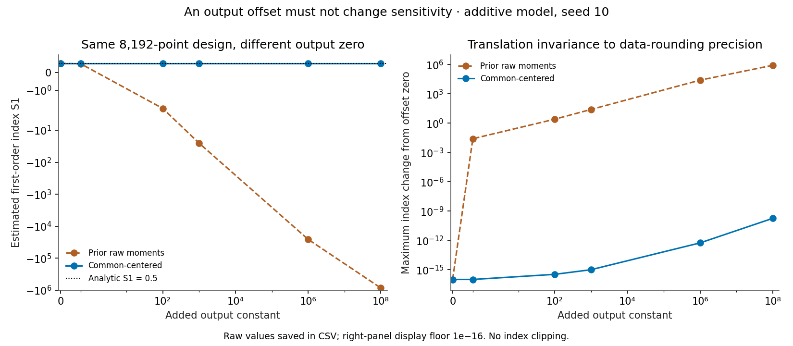

# 🧭 Variance Compass

**Which uncertain inputs drive a model's output, and which matter through
interactions?** A Python/NumPy sensitivity pipeline with seeded Saltelli
designs, centered covariance estimators, row-bootstrap uncertainty and
analytic Ishigami/additive benchmarks. No sensitivity-analysis library.

[](https://github.com/khalil-official/variance-compass/actions/workflows/ci.yml)
[](LICENSE)

## ▶️ Watch estimates approach the analytic values


[Open the animated GIF](docs/results/convergence.gif) ·
[Underlying estimates, SEs and percentile intervals](docs/results/convergence_sweep.csv)

Each of the 44 frames adds a recorded design from N=128 to N=262,144.
Left: first-order effects; right: total effects including interactions.
Dotted lines are analytic values. Whiskers are ±2 bootstrap standard
errors, **not exact 95% coverage intervals**. All plots use white interiors
without grids. Designs use a single documented random stream; this is
sample-size progression, not physical time or nested-sample refinement.

## 🎯 Purpose and scope

- Construct the (k+2)N crossed sampling design directly.
- Estimate first-order S and total-effect T indices using one common output
  center, so the result does not depend on the arbitrary output zero.
- Resample complete design rows jointly for uncertainty; every bootstrap
  replicate calls the same estimator.
- Compare estimates with exact indices, independent quadrature checks and
  a strictly additive anchor.
- Save numerical output and reproduce every published figure and GIF.

Inputs are independent uniform marginals and the model must return one
finite scalar per row. The package quantifies sampling uncertainty; it
does not validate an engineering model or support correlated inputs.

## 🧮 The estimator and why centering matters

For crossed outputs f(A), f(B), f(A_B^i), use the **same** pooled A/B mean m
for every output family. Write a=f(A)−m, b=f(B)−m, c_i=f(A_B^i)−m:

```text
Vhat = (mean(a²) + mean(b²))/2
S_i  = mean(b c_i)/Vhat
T_i  = 1 − mean(a c_i)/Vhat
```

All arrays are shifted by a reference value before estimating the center;
variance is never obtained by subtracting two large raw second moments.
These are consistent finite-sample covariance estimates, with no clipping
to [0,1]. Slightly negative estimates around a true zero can occur from
Monte Carlo variability. [Derivation and assumptions](docs/model.md).



For the same 8,192-row additive design, the old calculation changed S1
from about 0.506 to −25.32 after adding 1,000 to all outputs; at 10⁸ it
returned −854,719. The centered calculation retains S1≈0.50568 and pooled
variance≈0.6618755. Across all six tested offsets, the largest index change
is **1.83e-10**, consistent with rounding already present in the shifted
input data. No index is clipped or replaced with its analytic value.

[Raw offset comparison](docs/results/affine_invariance.csv).

## ⚡ Install and reproduce

```bash
git clone https://github.com/khalil-official/variance-compass.git
cd variance-compass
python -m venv .venv
# Windows: .venv\Scripts\activate
# Linux/macOS: source .venv/bin/activate
python -m pip install -r requirements-dev.txt
python -m pytest tests -q
python examples/run_verification.py
```

**88 tests pass** locally; CI runs on Ubuntu/Python 3.12. The recorded
default result run took about 47 s on this PC,
including 100 bootstrap replicates at each sweep size. Runtime depends on
BLAS threads and system load. Numerical runtime versions and seeds are in
[run_summary.json](docs/results/run_summary.json).

## 🧱 Use it on a model

```python
from variance_compass import analyze_sensitivity, ishigami, ishigami_bounds

result = analyze_sensitivity(
    ishigami, 2**16, ishigami_bounds(), seed=20261018, n_bootstrap=100
)
print(result.S, result.T)
print(result.S_se, result.S_ci)
```

Recorded N=65,536 estimates alongside analytic values:

```text
input    S est  S exact    T est  T exact
   x1   0.3144   0.3139   0.5561   0.5576
   x2   0.4438   0.4424   0.4367   0.4424
   x3  -0.0022   0.0000   0.2414   0.2437
```

x3 has zero first-order influence but a positive total effect because of
its interaction with x1. The small negative S3 estimate above is sampling
noise around zero. [API and validation behavior](docs/api.md).

```text
variance_compass/
  sampling.py      crossed designs and physical uniform bounds
  estimators.py    centered covariance and moment estimates
  sensitivity.py   model evaluation, joint row bootstrap and sweeps
  ishigami.py      nonlinear benchmark and analytic decomposition
  additive.py      independent additive anchor
tests/             statistical, analytic, affine and API regressions
examples/run_verification.py  reproduce saved data, figures and GIF
```

## 📊 Recorded benchmark results

Ishigami: a=7, b=0.1, independent U(−π,π), seed 20261018, 100 bootstrap
replicates, final sweep N=262,144. Estimating both families costs 5N model
evaluations per design; bootstrap reuses outputs without extra model calls.

| Index | Analytic | Estimate | ±2 SE | Absolute error |
| --- | ---: | ---: | ---: | ---: |
| S1 | 0.313905 | 0.314644 | 0.003687 | 0.000739 |
| S2 | 0.442411 | 0.444373 | 0.003730 | 0.001962 |
| S3 | 0.000000 | 0.004348 | 0.005268 | 0.004348 |
| T1 | 0.557589 | 0.554399 | 0.005361 | 0.003190 |
| T2 | 0.442411 | 0.443198 | 0.004365 | 0.000787 |
| T3 | 0.243684 | 0.243531 | 0.003281 | 0.000152 |

Pooled variance is 13.842700 versus analytic
13.844588, relative deviation
-0.0136%. The first sweep point with all
six absolute errors below 0.02 is **7,558**;
every later point meets that threshold only from
**15,361** onward. Sample error is not
monotonic; these two milestones should not be confused.

The four-input additive anchor has exact S=T=(0.53333,0.3,0.03333,0.13333).
At N=262,144 and seed 424242, max |S−analytic| is
0.00285, max |T−analytic| is
0.00205. This checks a model without interactions;
the Ishigami case checks interaction sensitivity separately.

## ✅ What verification establishes

The 88 collected cases cover model formulas, published analytic values,
independent trapezoidal integration, fixed-seed Monte Carlo comparisons,
cross-seed behavior, bootstrap scale, design structure, reproducibility,
and documented invalid inputs. Ten new cases check additive-offset/nonzero
scale invariance in every index API and bootstrap, a hand covariance
anchor at output offset 2⁴⁰, insufficient valid bootstrap replicates,
empty input dimension and nonrepresentable moments.

[Detailed tolerances and test measurements](docs/verification.md) ·
[Static convergence comparison](docs/results/convergence.png) ·
[Ishigami response surface](docs/results/ishigami_surface.png).

## 🔎 Limits

Monte Carlo error decreases approximately as N⁻¹ᐟ²; estimates and ratio
estimators have finite-sample bias. Bootstrap intervals with 100–200
replicates are noisy and have no exact coverage guarantee. Centering
cannot recover variation lost when extremely large offsets are rounded
in supplied outputs. Correlated/nonuniform inputs, time-dependent output
fields, experimental validation and expensive-model acceleration are
outside this version's scope. Seeds reproduce draws; last-bit results can
vary with numerical libraries and hardware.

## 📚 References and license

Mathematical references: Sobol', *Global sensitivity indices for nonlinear
mathematical models and their Monte Carlo estimates* (2001); Saltelli et
al., *Global Sensitivity Analysis: The Primer* (2008); Ishigami and Homma,
*An importance quantification technique in uncertainty analysis for
computer models* (1990). Full formulas and references are in the model guide.

Original code under [MIT](LICENSE). NumPy computes the estimates;
Matplotlib/Pillow generate the recorded visuals; pytest runs verification.

[Calendar metadata disclosure](docs/CALENDAR_HISTORY.md).
