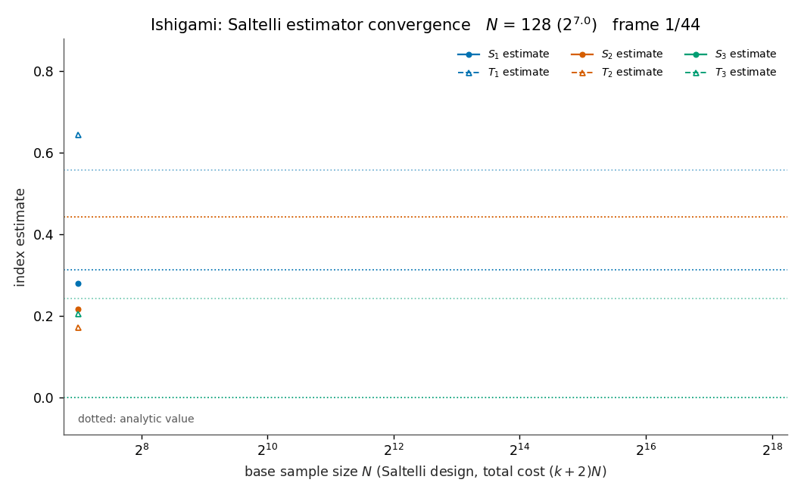

# Variance Compass

Uncertainty, interactions and sensitivity convergence: an original
Python/NumPy implementation of Monte Carlo uncertainty propagation and
variance-based (Sobol') sensitivity analysis, with reproducible seeded
sampling, bootstrap uncertainty, and exact analytic ground truth.



*Recorded estimator convergence: first-order `S_i` (circles) and
total-effect `T_i` (triangles) Monte Carlo estimates versus the exact
analytic indices (dotted lines) for the Ishigami function, as the base
sample size grows from N = 128 to N = 262,144. Shaded bands are
+/- 2 bootstrap standard errors. Every frame is real recorded data from
one seeded run (seed 20261018, 44 frames), generated by
`examples/run_verification.py`.*

## Purpose and scope

Global sensitivity analysis answers: which uncertain inputs drive the
output variance, and where do interactions hide? Variance Compass
implements the full pipeline from scratch and verifies it against
closed-form results:

- the **Saltelli (k+2)N sampling design** built directly from the
  mathematics with a seeded `numpy.random.Generator` (no
  sensitivity-analysis library is used anywhere);
- **first-order `S_i` and total-effect `T_i` estimators** in
  correlation form, with row-bootstrap standard errors and 95%
  percentile intervals;
- **convergence diagnostics**: estimates with uncertainty versus sample
  size `N` (CSV, plots, animated GIF);
- two analytic test beds: the **Ishigami function** (`a = 7`, `b = 0.1`)
  with its exact indices, and an **exactly decomposable additive model**
  as an exact-regression anchor;
- strict **input validation** on every public entry point.

Full theory and derivations: [docs/model.md](docs/model.md). API
reference: [docs/api.md](docs/api.md). Per-test evidence:
[docs/verification.md](docs/verification.md).

## Model summary

For independent inputs, the output variance decomposes orthogonally
into main effects and interactions. Two indices per input:

```
S_i = Var(E[f | X_i]) / V            (first-order, main effect)
T_i = E[Var(f | X_{~i})] / V         (total effect, includes interactions)
```

The Saltelli design evaluates the model on two independent base
matrices `A`, `B` and the `k` crossed matrices `A_B^(i)` (`A` with
column `i` taken from `B`), for a total cost of `(k+2)N` evaluations.
Because `f(B_j)` and `f(A_B^(i)_j)` share exactly the input `X_i`, the
product means estimate `f_0^2 + V_i`; because `f(A_j)` and `f(A_B^(i)_j)`
share everything except `X_i`, they estimate `f_0^2 + V - V_i_total`.
Ishigami's x1-x3 product term makes it the canonical interaction test:
`S_3 = 0` while `T_3 > 0`, and `1 - (S_1+S_2+S_3)` equals the exact
interaction share `V_13/V`.

## Quick start

```bash
git clone https://github.com/khalil-official/variance-compass.git
cd variance-compass
pip install -r requirements-dev.txt
pytest -q                                  # 78 tests, < 10 s
python examples/run_verification.py        # regenerates all artifacts
```

## API snippet (executed output)

```python
from variance_compass import (
    analyze_sensitivity, ishigami, ishigami_analytic, ishigami_bounds,
)

analytic = ishigami_analytic()
result = analyze_sensitivity(
    ishigami, 2**16, ishigami_bounds(), seed=20261018, n_bootstrap=100
)
print(f"{'input':>5} {'S est':>8} {'S exact':>8} {'T est':>8} {'T exact':>8}")
for i in range(3):
    print(
        f"{f'x{i+1}':>5} {result.S[i]:8.4f} {analytic.S[i]:8.4f} "
        f"{result.T[i]:8.4f} {analytic.T[i]:8.4f}"
    )
print(f"variance estimate {result.variance:.3f} (analytic {analytic.variance:.3f})")
print(f"S bootstrap SEs  : {result.S_se.round(4).tolist()}")
print(f"T bootstrap SEs  : {result.T_se.round(4).tolist()}")
```

Actual output (Python 3.13, NumPy 2.1.3):

```
input    S est  S exact    T est  T exact
   x1   0.3199   0.3139   0.5458   0.5576
   x2   0.4370   0.4424   0.4388   0.4424
   x3   0.0017   0.0000   0.2329   0.2437
variance estimate 13.802 (analytic 13.845)
S bootstrap SEs  : [0.0055, 0.0048, 0.0054]
T bootstrap SEs  : [0.0065, 0.0062, 0.0061]
```

Note the interaction fingerprint already visible at `N = 2^16`: `x3`
has essentially no first-order effect (`S_3 ~ 0`) yet a large total
effect (`T_3 ~ 0.23`) -- its variance contribution lives entirely in
the x1-x3 interaction.

## Metrics: Ishigami estimates vs analytic ground truth

Recorded by `examples/run_verification.py` (seed 20261018, bootstrap
B = 100; final sweep point N = 262,144 = 2^18; from
`docs/results/run_summary.json`):

| Index | Analytic (exact) | Estimate at N = 2^18 | +/- 2 SE (95%) | Abs. error |
|---|---|---|---|---|
| `S_1` | 0.3139 | 0.3103 | 0.0050 | 0.0036 |
| `S_2` | 0.4424 | 0.4430 | 0.0052 | 0.0006 |
| `S_3` | 0.0000 | 0.0038 | 0.0058 | 0.0038 |
| `T_1` | 0.5576 | 0.5525 | 0.0067 | 0.0051 |
| `T_2` | 0.4424 | 0.4383 | 0.0054 | 0.0041 |
| `T_3` | 0.2437 | 0.2378 | 0.0057 | 0.0058 |
| `V`   | 13.8446 | 13.8427 | -- | rel. err -0.014% |

Additive exact-regression anchor (`f = 2.0*x1 + 1.5*x2 + 0.5*x3 - 1.0*x4`,
seed 424242, N = 2^18): analytic `S = T = (0.5333, 0.3000, 0.0333,
0.1333)`; largest abs error **0.00285**, largest `|T_i - S_i|`
(analytically zero) **0.00443**. All six Ishigami indices sit within
0.02 of their analytic values from N = 5301 onward.

## Verification summary

- **78 pytest tests, all passing in ~7.5 s** (largest test N = 2^17);
  CI runs them on Ubuntu / Python 3.12 on every push and PR.
- Ishigami closed-form indices cross-checked three ways: published
  literature values (agreement 5e-5), an independent trapezoidal
  quadrature re-derivation of `V_i = Var(E[f|X_i])` and `V` (0.2%), and
  the Monte Carlo estimates above.
- Estimator primitives (`sample_mean`, `sample_variance`) verified
  against `numpy` on identical samples; structural properties asserted:
  `T_i >= S_i` (within 3 SE), `sum S_i <= 1` with the deficit matching
  the known x1-x3 interaction share, fixed-seed bit-reproducibility.
- Tolerances are statistical (> 3 bootstrap SE) and every quoted
  "observed" number is a measurement; details and caveats in
  [docs/verification.md](docs/verification.md).

## Limitations

- Monte Carlo error shrinks only as `n^(-1/2)`; the reported bootstrap
  SEs (and the GIF bands) quantify that spread but do not remove the
  estimators' `O(1/n)` bias from the estimated mean.
- Cost is `O(N(k+2))` model evaluations -- fine for cheap analytic
  models like these, expensive for heavy simulators.
- The additive anchor is exact only under independent inputs and its
  first-order-only structure; it cannot expose interaction-estimation
  errors (that is the Ishigami suite's job).
- Inputs are restricted to independent uniform marginals (inverse
  transform from `U(0,1)`); correlated inputs and non-uniform
  distributions are out of scope.
- Bootstrap percentile intervals from B = 100..200 replicates are
  themselves noisy and understate far-tail risk.

## References (by title)

- "Global Sensitivity Analysis: The Primer" -- Saltelli, Ratto, Andres,
  Campolongo, Cariboni, Gatelli, Saisana, Tarantola (Wiley, 2008)
- "Variance based sensitivity analysis of model output. The design and
  estimation of total sensitivity index" -- Saltelli, Annoni, Azzini,
  Campolongo, Ratto, Tarantola (Computer Physics Communications, 2010)
- "Sensitivity estimates for nonlinear mathematical models" --
  I. M. Sobol' (1993); "Global sensitivity indices for nonlinear
  mathematical models and their Monte Carlo estimates" -- I. M. Sobol'
  (Mathematics and Computers in Simulation, 2001)
- "An importance quantification technique in uncertainty analysis for
  computer models" -- Ishigami and Homma (Proc. ISUMA, 1990)

## License

MIT -- see [LICENSE](LICENSE). Copyright (c) 2026 MOHAMMED AHMED.
